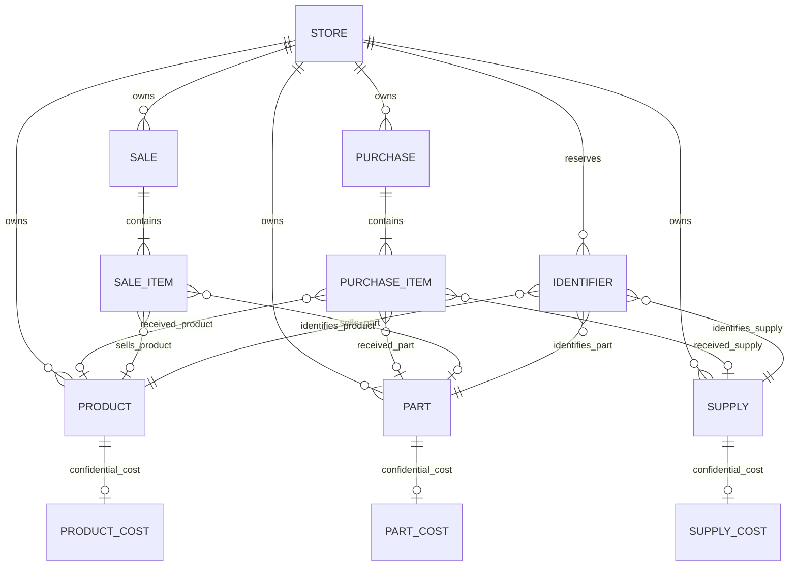

# Phone Clinic — Phase A specification

**Status:** The original Phase A proposal below is retained as design context. Supplier purchase invoices have since been implemented in the application and Firestore rules have been updated locally; the rules have not been deployed and no data migration has been run.

## 1. Goal and boundaries

Phase A establishes one canonical stock record per inventory item, separates confidential purchase costs from employee-readable documents, defines unique identifier reservation, and plans a reversible migration. Existing repair, POS, sales, and product behavior must remain operational until a tested cutover.

In scope for design:

- `products` for products and services, `parts` for spare parts, and `supplies` for stockable operating supplies.
- Private `product_costs`, `part_costs`, and `supply_costs`.
- `purchases` as the vendor purchase/receipt transaction record; `sales` remains the customer-sale record.
- Store-scoped barcode/reference reservation and migration of legacy data.

Not in scope yet: changing role claims, payroll/accounting UI, replacing the repair workflow, running migrations, deploying Cloud Functions, or changing live Firestore rules.

## 2. ERD



`STORE` is a logical ownership boundary, not a proposed new collection. All tenant-owned documents use `ownerId`. Relationship arrows indicate references, not a promise of relational constraints in Firestore. Service records are non-stockable and do not receive stock cost documents unless a specific future requirement establishes one.

## 3. Proposed document schemas

All monetary fields below are integers in millimes (`1 DT = 1000 millimes`) for new records. All quantity fields are nonnegative integers. Existing numeric dinar values are not reinterpreted or overwritten during backfill.

### 3.1 Catalog and stock

| Collection / document | Proposed fields | Access intent |
|---|---|---|
| `products/{productId}` | `ownerId`, `type: 'product' \| 'service'`, `name`, `categoryId?`, `description?`, `barcode?`, `reference?`, `quantity` only when stockable (integer), `sellPriceMilli?`, `lowStockAlert?`, `active`, `createdAt`, `updatedAt` | Same-store employees receive only operational fields they need. No purchase cost, margin, or salary fields. |
| `parts/{partId}` | `ownerId`, `type: 'spare_part'`, `name`, `brand?`, `modelCompatibility?`, `barcode?`, `reference?`, `quantity` (integer), `sellPriceMilli`, `lowStockAlert?`, `active`, `createdAt`, `updatedAt` | Technician may read same-store name/reference/availability and selling price for permitted repair workflow; no purchase cost. Owner may manage. |
| `supplies/{supplyId}` | `ownerId`, `type: 'operating_supply'`, `name`, `barcode?`, `reference?`, `quantity` (integer), `unit?`, `active`, timestamps | Stockable internal-use/consumable catalog item, not a receipt. No purchase cost. Read/write permissions must be specified by the approved inventory role policy. |

**Type decision:** `type` is collection-specific, not a global discriminator that makes the three collections interchangeable. Proposed allowed values are `product`, `service`, `spare_part`, and `operating_supply` in their respective collections. For `service`, quantity is not meaningful; omit it and validate that type. Do not store fake zero inventory for services.

Suggested safe Firestore field names for the `quantity` migration are not yet a compatibility decision. Existing code reads/writes `products.stock`; changing it to `quantity` before all POS, Repairs, Dashboard, and Products readers have migrated would break current behavior. During a staged rollout either keep `stock` as the sole canonical field until all clients switch, or define a short-lived synchronized compatibility adapter with one authoritative field and remove it only after old clients are retired. Never independently maintain both `stock` and `quantity`.

### 3.2 Confidential cost documents

| Collection / document | Proposed fields | Rules intent |
|---|---|---|
| `product_costs/{productId}` | `ownerId`, `productId`, `currentUnitCostMilli`, `updatedAt`, `updatedBy` | Whole-document read/write limited to the store principal admin until access levels are explicitly approved. |
| `part_costs/{partId}` | `ownerId`, `partId`, `currentUnitCostMilli`, `updatedAt`, `updatedBy` | Same. |
| `supply_costs/{supplyId}` | `ownerId`, `supplyId`, `currentUnitCostMilli`, `updatedAt`, `updatedBy` | Same. |

Purchase history should be an immutable cost snapshot under private `purchases/{purchaseId}` / purchase line data, or private `purchase_costs/{purchaseId_itemId}` records, not an employee-readable catalog field. Which exact form is chosen depends on whether any non-admin should read purchase headers without costs. Do not put cost fields in a readable `purchases` document and assume field-level Firestore rules can hide them.

**Security fact:** Firestore rules can allow/deny a document read/write; they do not return a sanitized subset of that document. Consequently, “collection-level plus field-level” protection is not an available rule feature. Separate sensitive fields/documents into non-readable collections and remove legacy copies from employee-readable documents. For writes, validate the allowed field set and role; this is not a mechanism to conceal selected fields on reads.

### 3.3 Purchasing and sales records

| Collection / document | Proposed fields | Notes |
|---|---|---|
| `purchases/{purchaseId}` | `ownerId`, `date`, `supplierId?`, `supplierName?`, `items: [{ itemCollection, itemId, nameSnapshot, quantity, unitCostMilli? }]`, `totalMilli?`, `notes?`, `status`, `createdAt`, `createdBy`, `migrationSourceId?` | Vendor receipt/purchase event. Restrict the full document if line costs are included. Keep purchase cost snapshots immutable; current catalog costs can change later. Do not increment migrated legacy stock a second time. |
| `sales/{saleId}` | Existing sale data remains during Phase A. New item references should include `itemCollection: 'products' \| 'parts'` and stable `itemId`; preserve name/price/quantity/total snapshots. | Do not put `buyPrice` in sale documents. Existing customer-sale and invoice flows need a coordinated follow-on client change before spare parts can safely be sold from `parts`. |

`supplies` is proposed as an inventory catalog, while `purchases` is the historical/vendor transaction. The existing legacy `supplies` collection currently contains incoming stock records, not a stockable supplies catalog. Its migration therefore must not blindly rename each old receipt into a supplies inventory item.

### 3.4 Identifier registry

Use one reservation document per store, identifier kind, and normalized value:

```text
identifier_registry/{safeKey}
{
  ownerId,
  identifierType: 'barcode' | 'reference',
  normalizedValue,
  itemCollection: 'products' | 'parts' | 'supplies',
  itemId,
  createdAt,
  updatedAt
}
```

Create `safeKey` from an unambiguous encoding/hash of `(ownerId, identifierType, normalizedValue)`; retain `normalizedValue` in the document to detect hash collisions. Define normalization before migration (recommended: Unicode normalize + trim + case-fold references; preserve documented barcode semantics and do not strip meaningful characters without a product decision). Decide whether blank/null identifiers are omitted and whether uniqueness is store-wide across all three collections (recommended: yes, separately per identifier type).

### 3.5 Logical constraints / invariants

1. Every catalog, cost, purchase, sale, and identifier document is assigned to exactly one `ownerId`; clients must not set another store's owner ID.
2. Each stockable item has exactly one authoritative integer quantity in one catalog collection.
3. Services are not stock items and cannot be consumed as parts or decremented at POS.
4. Each non-empty normalized barcode/reference maps to at most one active catalog item per store, across all three catalog collections.
5. Cost documents are keyed deterministically by the associated item ID and carry the same `ownerId`.
6. Purchase migration records historical events only; opening stock is preserved from the current canonical item quantity and not re-added.
7. Legacy sales/repairs retain stable links. During catalog moves, identifiers/references must be resolvable without guessing from duplicate IDs in different collections.

## 4. Uniqueness and Cloud Functions design

Firestore has no native unique constraint and security rules cannot query the entire collection to prove a proposed barcode/reference is unused. A client preflight query followed by a write is race-prone: two clients can both see “unused” before either writes.

**Recommended enforcement:** one callable/server command for catalog create/update/delete:

1. Authenticate the Firebase ID token and derive/verify the caller's store and approved inventory permission on the server.
2. Normalize identifiers consistently and compute the deterministic registry document IDs.
3. In one Firestore transaction, read all newly requested registry keys; reject keys owned by a different item; then write the catalog document, reserve the new keys, and release old keys only if still owned by that same item.
4. Keep the catalog mutation and registry changes atomic. Enforce quantity/type validation in the same command.
5. Restrict direct client catalog writes so all identifier-changing writes go through this path. Firestore rules validate callers/fields as defense in depth; they do not establish uniqueness.

A Firestore trigger can audit already-committed writes or repair/report legacy inconsistencies, but it cannot act as a pre-commit uniqueness constraint: conflicting writes may already be visible before the trigger runs. Therefore a trigger is a detection/reconciliation backup, not a second enforcement authority. “Five Cloud Functions for uniqueness” is not justified by five collections; one shared transactional command should cover all catalog types, plus narrowly scoped triggers only if a concrete audit/reconciliation requirement is approved.

The repository has `server.ts` with Express and Firebase Admin SDK, but the inspected root has no `firebase.json` and no Functions source/package setup. The presence of Admin SDK dependencies does not establish deployed Cloud Functions. Before choosing a callable Function versus the existing server, confirm hosting, credentials, environments, and release ownership. No endpoint/function should be deployed as part of this specification.

## 5. Migration plan (non-destructive; no execution yet)

### 5.1 Existing data facts relevant to migration

- Existing `products` documents contain `buyPrice`, `sellPrice`, `stock`, optional `reference`/`barcode`, and owner identity ([src/types.ts:8-21](../src/types.ts:8)). `isSparePart()` currently classifies using text in name/category/reference/barcode, not a durable type field ([src/lib/utils.ts:8-20](../src/lib/utils.ts:8)).
- Existing `supplies` records are created for initial stock and restocks with `productId`, `productName`, `quantity`, `buyPrice`, `totalCost`, date, and owner ([src/components/Products.tsx:339-350](../src/components/Products.tsx:339), [src/components/Products.tsx:397-416](../src/components/Products.tsx:397)).
- POS and repairs refer to product IDs and directly read/update `products.stock` today ([src/components/POS.tsx:569-615](../src/components/POS.tsx:569), [src/components/Repairs.tsx:795-835](../src/components/Repairs.tsx:795)). Switching collections without updating both paths would split or break stock.

### 5.2 Safe sequence

1. **Inventory/backup:** export the scoped existing `products`, `supplies`, `sales`, `repairs`, and `invoices` data; record per-owner counts, stock totals, cost-field counts, duplicates, missing IDs, and negative stock. Store export access must be restricted because it includes costs.
2. **Dry-run classification:** propose which existing products map to parts using `isSparePart()` only as a candidate; produce an owner-review list for ambiguous matches. Do not auto-classify solely from names. Identify services/non-stockable items and resolve duplicate barcode/reference values before reserving identifiers.
3. **Shadow copy:** create target catalog records with stable migration mapping. Copy ordinary products/services to `products`, approved spare parts to `parts`, and actual consumable catalog items (if any) to `supplies`. Preserve source document IDs where possible; otherwise write a protected `migration_map/{sourceCollection_sourceId}`. Do not delete/overwrite source records yet.
4. **Backfill private costs:** copy `products.buyPrice` to `product_costs` or `part_costs` based on approved mapping. Values from legacy `supplies` should be retained as purchase-line cost snapshots (the event's historical cost), not treated as current `supply_costs` unless an actual supply catalog item is linked. Mark uncertain or missing historical cost explicitly; do not infer it from today's cost.
5. **Backfill purchases:** convert each legacy `supplies` receipt to a `purchases` record with `migrationSourceId` and original document ID. Preserve date/quantity/total and product linkage; supplier fields remain unknown/null if not present in the source. Treat the record as history only: do not apply its quantity to catalog stock a second time.
6. **Identifier registry:** populate reservations transactionally and report conflicts. Do not choose a winner silently when duplicate normalized values exist; resolve with an owner decision.
7. **Verification:** compare source/target record counts, stock quantities, references, costs, purchase totals, and repair/sale links per owner. Sample records manually and test with owner, technician, cashier, and another store. No reader cutover until every mismatch is explained.
8. **Cutover:** in a planned maintenance/version gate, switch POS, Products, Repairs, and reports to the canonical collection mapping. Route identifier and quantity mutations through the chosen trusted command path. Tighten rules and remove legacy cost copies from `products`, `supplies`, sales item snapshots, and `repairs.parts[].unitBuyPrice` only after no deployed client requires them.
9. **Rollback/retention:** retain source export and migration map throughout a defined rollback window. Roll back readers to the old data only while explicitly protecting costs; never restore plaintext legacy cost fields under broad authenticated-read rules. Make each migration step idempotent and record a version/status so reruns do not duplicate purchases or quantities.

**Downtime caution:** a dual-read/dual-write migration across old and new stock collections can diverge. Safer default is a short write freeze or version-gated cutover after shadow verification; “zero downtime” is not guaranteed by this schema alone. If old installed clients may continue writing, the compatibility and retirement plan must be designed before enabling the new authoritative stock.

## 6. Test and acceptance plan

No test framework or Firebase Emulator configuration was confirmed during the initial analysis; `package.json` exposes `build`, `lint`, and `start`, but no test script ([package.json:6-13](../package.json:6)). Testing tooling/configuration is a prerequisite decision before promising unit/security coverage.

Acceptance tests for implementation should include:

- Schema validation: valid/invalid type and quantity combinations, required owner, services with no stock, and no cost fields on employee-readable documents.
- Identifier concurrency: two parallel creates for the same normalized barcode/reference yield exactly one success; reference and barcode namespaces remain independent; edits release/reserve safely; delete only releases owned keys; hash collision is detected.
- Tenant/permission isolation: cross-store gets/lists/writes fail; technician/cashier cannot read cost collections or writes; authorized principal can read/write; client cannot bypass server identifier command with direct writes.
- Migration dry-run: rerun is idempotent; legacy supply receipt does not add stock twice; owner partitions and totals reconcile; ambiguous classification and duplicates are surfaced rather than silently migrated.
- Integration regression: POS sells an item once; Repairs uses the same canonical part quantity; invoices/sales preserve existing behavior; services cannot decrement stock; reports do not expose margins/costs to unauthorized profiles.
- Import/export validation: round-trip preserves IDs, `ownerId`, reference/barcode normalization, quantities, timestamps, and cost precision; imported duplicates fail with an actionable report.

## 7. Risks and decisions required before coding

1. **Meaning of `supplies` — confirmed:** it is a stockable consumables catalog, while old `supplies` records become historical `purchases` only; migration must not apply their quantities to stock again.
2. **Cost visibility conflict:** decision 2 says cost read/write is admin-only; decision 5 says Managers and Admins see costs; decision 6 says Inventory Manager sees “some” costs. Recommended Phase A default: principal store admin only until a precise per-collection cost policy is approved. Do not implement a broader role policy by guess.
3. **Role-model conflict:** the existing app stores only `admin | user` and models technician as a `user` profile preset with `allowedMenus`; the previous analysis explicitly recommends preserving this ([src/types.ts:75-88](../src/types.ts:75), [src/components/Users.tsx:45-49](../src/components/Users.tsx:45), [src/components/Users.tsx:281-284](../src/components/Users.tsx:281)). The new five-role decision changes that model and is a Phase B design decision, not needed for Phase A schema. Decide whether the five labels will be custom claims/presets while storage remains `admin | user`, or actual new authorization values. Recommended: keep current stored role values and define permission presets first.
4. **Part migration compatibility:** existing repairs and sales store product IDs without an explicit catalog collection discriminator. Approve a stable ID/mapping strategy and the simultaneous consumer changes before moving any product to `parts`.
5. **`quantity` versus `stock`:** existing readers/writers use `stock`, while the new shared schema requests `quantity`. Choose a migration compatibility window and canonical field before changing documents; never maintain both independently.
6. **Purchasing supplier details:** legacy supply records have no confirmed supplier field in the current writer. Supplier name/ID for historical purchases must remain unknown unless verified from another source.
7. **Functions hosting/security:** confirm whether to add Firebase Functions infrastructure or use the existing Express server. The current source does not prove either is deployed for new stock commands. Admin SDK endpoints must explicitly verify store, permissions, input, and transaction invariants because they bypass Firestore rules.
8. **Uniqueness policy:** confirm store-wide uniqueness across products, parts, and supplies, and the normalization rules for barcodes/references. Recommended: unique per store and identifier type across all three collections, with a reviewed duplicate report before cutover.
9. **Service costs and stock:** confirm whether services can have direct cost/margin records. Recommended: no quantity and no catalog cost document for services in Phase A; capture any labor/service expense in a later accounting ledger.
10. **Legacy cost completeness:** older repairs may lack a cost snapshot; current product cost is not reliable historical evidence. Recommended: preserve unknown as unknown and mark any owner-approved estimate explicitly.

## 8. Original Phase A implementation gate

This gate describes the original proposal and its unimplemented migration. It does not describe the separately requested supplier-invoice work below. No migration or deployment is included in that work.

## 9. Implemented supplier purchase invoices

The application now uses the following store-scoped records:

- `purchases/{purchase_<ownerId>_<normalizedNumber>}`: invoice header, supplier snapshot, item snapshots, total/paid/debt in millimes, status, optional HTTPS or compressed image attachment, and cancellation metadata.
- `suppliers/{supplierId}`: supplier name and optional phone.
- `supplier_debts/{supplierId}`: aggregate balance in millimes; `payments/{paymentId}` stores initial payments, later settlements, and cancellation credits.
- `product_costs/{itemId}` or `part_costs/{itemId}`: latest `buyPrice` in dinars for existing readers plus `currentUnitCostMilli`.
- `stock_movements/{movementId}`: one `purchase_restock` per received line and one `purchase_cancel` per successfully reversed line.

Creating an invoice, receiving stock, writing purchase movements and costs, updating supplier debt, and recording any initial cash-session outflow are performed in one Firestore transaction. Later settlements also require an open cash session and update the invoice, supplier debt, payment history, and session totals atomically; they do not create a separate `expenses` document. Cancellation is explicit, never deletes the invoice, and is refused when any affected item lacks sufficient stock. Payments already made are retained and become a supplier credit on cancellation.

The local `firestore.rules` file now restricts `purchases`, `suppliers`, `supplier_debts`, and their payment subcollection to the store owner-admin, validates purchase-linked stock movements and payments, and denies deletion. The cost-collection rules retain the application's pre-existing permission behavior. These rules have not been deployed. No production data was changed.

Automated purchase-accounting tests cover the 10-chargeur acceptance values (stock +10, unit cost 15 DT, total 150 DT, payment 100 DT, debt 50 DT), clearing the remaining 50 DT, and refusing cancellation when stock is insufficient. These tests exercise the shared accounting/stock helpers, not a live Firestore emulator transaction. Run them with `npx tsx --test src/lib/purchaseAccounting.test.ts`.
